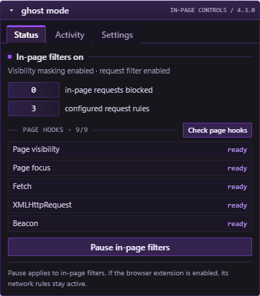

# Canvas Ghost Mode

A Chrome and Edge extension that masks Canvas page visibility and blocks selected activity requests. Version 4.3 adds a compact charcoal-and-violet panel with draggable controls and tabs.

> [!WARNING]
> I haven't verified this release on a live Canvas instructor account because I don't currently have one available. Instructure permanently discontinued Free-for-Teacher after the 2026 security incidents. [Instructure's incident update](https://www.instructure.com/incident_update)
>
> The local tests pass, so I expect the listed filters to work, but live Canvas compatibility is unverified. Use at your own risk. If you're unsure, try it in a VM with a separate browser profile first.



## Install

1. Download the extension ZIP from [Releases](https://github.com/bodanator/canvas-ghost-mode/releases/latest) and extract it to a permanent folder.
2. Open `chrome://extensions` or `edge://extensions`, turn on **Developer mode**, and choose **Load unpacked**.
3. Select the extracted folder containing `manifest.json`. The browser lists the extension as **Canvas Ghost Mode Network Filter**.
4. Disable any older Canvas Ghost Mode Tampermonkey copy, then refresh your Canvas page. The panel starts in the bottom-right corner.

For a source checkout, load the `extension` folder directly. To update an existing unpacked installation, replace its files, click **Reload** on the extension card, and refresh Canvas.

Supported hosts are `instructure.com`, its subdomains, and `canvas.<school>.edu`. If the panel is missing, check **Details → Site access** on the extension card. Other hostnames need matching content-script settings and network rules.

## Controls

- Drag the title bar to move the panel.
- Use the title-bar triangle or `Alt+Shift+G` to collapse or expand it.
- Use the Status button or `Alt+Shift+P` to pause or resume page filters.
- **Check page hooks** checks and reattaches the browser API hooks.
- **Settings** contains the filtering options and position reset.

Settings are saved per Canvas site. Each matching frame has its own hooks and diagnostics, and the main page shows the panel.

## Network coverage

The extension's browser network rules block these writes on supported hosts, including requests from workers and saved browser API references.

| Endpoint | Blocked methods |
| --- | --- |
| `/page_views` and `/api/v1/page_views` | `POST` |
| `/page_views/<id>` and `/api/v1/page_views/<id>` | `POST`, `PUT`, `PATCH` |
| `/api/v1/courses/<course>/quizzes/<quiz>/submissions/<submission>/events` | `POST` |

Rules accept query strings, optional trailing slashes, encoded letters in `page_views` and `events`, and encoded decimal course/quiz IDs. The Classic Quiz rule suppresses the entire event batch at its endpoint.

Pausing the panel pauses its visibility masking and fetch/XHR/beacon hooks. The extension's network rules stay active until you disable the extension. The panel counter covers requests intercepted by that page's hooks.

Ordinary course loads, answer saves, and final submissions reach Canvas and can create server records. Other endpoints, custom hosts, and New Quizzes need separate coverage. Canvas can detect or replace page hooks.

The extension makes no requests of its own. It saves panel settings locally and keeps a bounded activity log in memory. The log contains rule names and hook notices, without request URLs, bodies, or timestamps.

## Build and verify

Python 3 builds the ZIP and standalone userscript. Node.js 20+ and Playwright run the browser tests. The installed extension has no runtime dependencies.

```sh
python scripts/build.py
npm ci
npx playwright install chromium
npm test
```

Builds appear in `dist`. For an existing Chromium or Chrome for Testing installation, set `CHROME_PATH` to its executable before running the tests.

Version 4.3.0 was tested in Chrome for Testing 156.0.8078.4 with isolated profiles and a local HTTP receiver.

- All 13 targeted activity writes arrived with the extension disabled. None arrived with it enabled.
- All 9 allowed requests arrived in both runs. Answer-save and final-submission methods and bodies were preserved.
- The targeted cross-origin preflight arrived only with the extension disabled.
- All 7 panel scenarios passed, including shortcuts, dragging, saved settings, body replacement, frame scope, and a 375-pixel viewport.

The network cases cover fetch, XHR, beacons, dedicated and service workers, cross-origin requests, form POSTs, both hostname patterns, and encoded routes. Tests load the actual unpacked extension and write results to `test-results`.

The page hooks and UI are in `extension/panel.js`. `scripts/build.py` generates the manifest, network rules, ZIP, and standalone userscript. Browser tests are in `tests`.

Based on the original Canvas Ghost Mode userscript by realdawgace. The original attribution is preserved in `extension/panel.js`.
